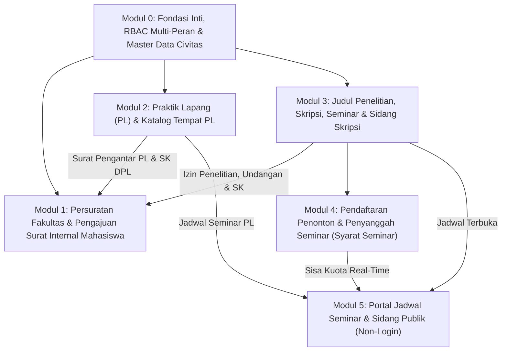

# Blueprint & Checklist Pembangunan Ulang — Sistem Informasi Terpadu FPST UPB

Dokumen ini adalah **handout spesifikasi & checklist implementasi dari nol** (*build-from-scratch blueprint*) untuk membangun kembali **Sistem Informasi Terpadu Fakultas Pertanian, Sains dan Teknologi (FPST) — Universitas Panca Bhakti (UPB)**. Seluruh fase pengembangan sebelumnya telah dirangkum menjadi **checklist terstruktur** agar model AI atau pengembang lain dapat membangun ulang sistem ini secara utuh, aman, teruji, dan siap beban puncak (*peak traffic*).

Panduan sistem desain visual (warna *Sage Botanical*, tipografi, komponen UI, modal, dan layout PDF) tersedia pada [system_design.md](system_design.md).

---

## 1. Aturan & Konvensi Mutlak Proyek

1. **Identitas Fakultas**: Gunakan nama resmi **Fakultas Pertanian, Sains dan Teknologi**, disingkat **FPST** Universitas Panca Bhakti.
2. **Program Studi Resmi**:
   - **Agroteknologi** (kode: `AGT`)
   - **Agribisnis** (kode: `AGB`)
   - Seluruh seeder, kasus uji (*test case*), dan contoh data wajib merefleksikan `AGT` dan `AGB`.
3. **Terminologi Baku**:
   - Gunakan istilah **Sidang Skripsi** secara konsisten pada antarmuka (UI), log aktivitas, notifikasi, validasi, kode, dan dokumen surat.
   - **Dilarang** menggunakan istilah `"sidang meja hijau"` atau `"meja hijau"`.
4. **Batasan Ruang Lingkup (Modul 0 – Modul 5)**:
   - Hanya mencakup Modul 0 sampai Modul 5 sesuai cetak biru di bawah ini (tidak menyertakan Modul 6 atau modul lain di luar kesepakatan).

---

## 2. Stack Teknologi & Konfigurasi Inti

| Komponen | Spesifikasi |
|---|---|
| **Backend & PHP** | PHP `^8.2`, Laravel Framework `^12.0` (`composer.json`) |
| **PDF & QR Generator** | `dompdf/dompdf: ^3.1` (`isRemoteEnabled = false`), `chillerlan/php-qrcode: ^6.0` |
| **Frontend Build** | Tailwind CSS `^4.0`, Vite `^6.0` (`package.json`), Tema *Sage Botanical* (`system_design.md`) |
| **Database** | MySQL (`project_fpst` utama & `project_fpst_testing` untuk PHPUnit) |
| **Peak Scale (Produksi)** | Redis untuk `SESSION_DRIVER`, `CACHE_STORE`, `QUEUE_CONNECTION` + Queue Worker (`php artisan queue:work`) |
| **Testing** | PHPUnit `^11.5` |

### Kunci Konfigurasi (`config/fpst.php` & `.env.example`)
- `fpst.seminar_audiens.maks_total_tonton` = `12` (maksimal menonton seminar per mahasiswa, sudah termasuk penyanggah)
- `fpst.seminar_audiens.maks_penyanggah_per_mahasiswa` = `2` (maksimal berperan sebagai penyanggah; selebihnya peserta)
- `fpst.seminar_audiens.maks_kuota_sesi` = `35` (maksimal total penonton per sesi seminar)
- `fpst.seminar_audiens.enforce_syarat_seminar` = `env('FPST_ENFORCE_SYARAT_SEMINAR', true)`
- `fpst.praktik_lapang.min_sks` = `env('FPST_PL_MIN_SKS', 90)`
- `fpst.praktik_lapang.default_kuota_periode` = `10`
- `fpst.surat_internal.qr_verifikasi_enabled` = `env('FPST_SURAT_QR_VERIFIKASI', false)`
- `fpst.peak_performance.jadwal_cache_ttl_seconds` = `env('FPST_JADWAL_CACHE_TTL', 300)`
- `fpst.peak_performance.security_headers_enabled` = `env('FPST_SECURITY_HEADERS', true)`

---

## 3. Peta Arsitektur Sistem (Modul 0 – Modul 5)

---

## 4. Desain Skema Basis Data & RBAC

### A. Peran Pengguna (`App\Enums\UserRole`)
1. `mahasiswa` — Mahasiswa aktif (`AGT`/`AGB`)
2. `dosen` — Dosen pembimbing, penguji, & DPL
3. `kaprodi` — Ketua Program Studi (terisolasi per `program_studi_id`)
4. `admin_prodi` — Admin Program Studi (terisolasi per `program_studi_id`)
5. `tendik` — Tenaga Kependidikan / Staf Tata Usaha Akademik Fakultas
6. `pimpinan_fakultas` — Dekan / Pimpinan Fakultas
7. `admin_utama` — Administrator sistem lintas prodi & fakultas

> **Multi-Peran**: Selain `users.role` utama, tabel pivot `user_roles` (`user_id`, `role`, `program_studi_id`) memungkinkan satu civitas merangkap beberapa peran aktif (misal: `dosen` + `kaprodi` atau `tendik` + `admin_prodi`).

### B. Ringkasan Tabel & Indeks Peak
- **Fondasi & RBAC**: `program_studi` (termasuk `file_ttd_kaprodi` di disk privat `local`), `users` (`role`, `program_studi_id`, `nomor_induk`, `no_hp`, `jabatan`, `unit_kerja`), `user_roles`, `aktivitas_log`, `notifikasi`, `jobs`, `cache`.
- **Modul 1 (Persuratan)**: `pengajuan_surat`, `penomoran_surat_counters` (`kode_unit`, `tahun`, `last_number`), `surat` (mendukung `pengajuan_skripsi_id` nullable, `pengajuan_surat_id`, `praktik_lapang_id`, `verification_token`, `verification_hash`, `penanda_tangan_id`, `jabatan_penanda_tangan`).
- **Modul 2 (Praktik Lapang)**: `lokasi_pl` (`sektor`, `kuota_periode`, `status_verifikasi`), `praktik_lapang` (`sks_ditempuh`, `periode_akademik`, `pengajuan_surat_id`, `dpl_id`, `nomor_sk_dpl`, jadwal & nilai seminar PL), `logbook_pl`.
- **Modul 3 (Skripsi)**: `pengajuan_skripsi`, `seminar_skripsi` (`kuota_penonton`, `kuota_penyanggah`, `pendaftaran_audiens_dibuka`, `token_presensi`, `hasil_evaluasi`, `rincian_nilai`, `catatan_revisi`, `tenggat_revisi`, `bebas_revisi_at`, `bebas_revisi_oleh`), `sidang_skripsi` (plus `predikat_yudisium`), `penugasan_dosen` (polimorfik `assignable` termasuk tipe `dpl`).
- **Modul 4 (Audiens Seminar)**: `seminar_audiens` (`unique(seminar_skripsi_id, mahasiswa_id)`).
- **Indeks Komposit Peak**: `fpst_skripsi_prodi_status_idx`, `fpst_seminar_tgl_status_idx`, `fpst_sidang_tgl_status_idx`, `fpst_notifikasi_user_dibaca_idx`, `fpst_pengajuan_surat_prodi_status_idx`, `fpst_aktivitas_user_created_idx`.

---

## 5. Checklist Pembangunan dari Awal (Step-by-Step Build Checklist)

### Tahap A — Setup Proyek, Konvensi & UI Dasar
- [ ] Inisialisasi proyek Laravel 12 (`PHP ^8.2`), install `dompdf/dompdf` (`^3.1`), `chillerlan/php-qrcode` (`^6.0`), dan Tailwind CSS `^4.0` + Vite `^6.0`.
- [ ] Konfigurasi `GEMINI.md` dan `config/fpst.php` beserta `.env.example` (`DB_CONNECTION=mysql`, konfigurasi Redis produksi, variabel `FPST_*`).
- [ ] Implementasikan layout utama (`resources/views/layouts/app.blade.php`), `landing.blade.php`, dan styling *Sage Botanical* sesuai `system_design.md`.
- [ ] Buat seeder `DatabaseSeeder` dengan Program Studi resmi **Agroteknologi (`AGT`)** dan **Agribisnis (`AGB`)** beserta akun contoh semua peran.

### Tahap B — Fondasi Keamanan, RBAC Multi-Peran & Integritas Sistem (Modul 0)
- [ ] Buat Enum `UserRole` (7 peran) dan model `UserRoleAssignment` + relasi `extraRoles()` pada `User` (mendukung pengecekan `hasRole()`/`hasAnyRole()`).
- [ ] Buat & daftarkan middleware `EnsureUserHasRole` (`role:...`), `EnsureUserIsAdminUtama` (`admin_utama`), dan `ApplySecurityHeaders` secara global di `bootstrap/app.php` (`X-Frame-Options`, `X-Content-Type-Options`, `Referrer-Policy`, `Permissions-Policy`, `Content-Security-Policy`).
- [ ] Kunci seluruh route group di `routes/web.php` berdasarkan peran, isolasi scope `program_studi_id` di kontroler `Kaprodi` dan `AdminProdi`, dan abaikan manipulasi query parameter lintas prodi.
- [ ] Bangun `DokumenController` dengan validasi base64 ketat, anti-path-traversal (`..`, `\`, `\0`), pembatasan prefix direktori privat (`skripsi/`, `seminar/`, `sidang/`, `surat_internal/`, `praktik_lapang/`), verifikasi kepemilikan record di DB per peran, dan header `X-Content-Type-Options: nosniff`.
- [ ] Simpan file `file_ttd_kaprodi` di disk privat `local`, layani hanya via route terotentikasi `admin_utama`, dan nonaktifkan `isRemoteEnabled` pada seluruh render PDF Dompdf.
- [ ] Validasi redirect URL pada `NotifikasiController` agar hanya mengarah ke path internal / host aplikasi.
- [ ] Bangun Master Data (`Admin\Master\*`: Mahasiswa + `MahasiswaCsvImporter`, Dosen, User + multi-role, ProgramStudi, AdminProdi) serta `LogAktivitasController`.

### Tahap C — Sistem Persuratan & Surat Internal Mahasiswa (Modul 1)
- [ ] Buat Enum `JenisSuratInternal` dan `StatusPengajuanSurat`, model `PengajuanSurat`, `PenomoranSuratCounter`, serta perluasan model `Surat`.
- [ ] Implementasikan `SuratInternalService` dengan penomoran atomik bebas duplikasi (`DB::transaction` + `lockForUpdate()` pada `penomoran_surat_counters`).
- [ ] Implementasikan `QrCodeService` (berbasis `chillerlan/php-qrcode`) dan `VerifikasiSuratController` (`/verifikasi-surat/{token}`), yang dapat diaktifkan/nonaktifkan melalui `config('fpst.surat_internal.qr_verifikasi_enabled')`.
- [ ] Implementasikan generator PDF surat resmi (`SuratUndanganService` & template Blade PDF termasuk `pdf/surat-internal.blade.php`).
- [ ] Buat antarmuka pengajuan surat mahasiswa (`Mahasiswa\PengajuanSuratController`) dan alur disposisi bertahap pengelola (`Admin\PersuratanController`: verifikasi Tendik/Admin -> persetujuan Kaprodi/Pimpinan -> penerbitan nomor & PDF).

### Tahap D — Pengajuan Skripsi, Seminar & Sidang Skripsi (Modul 3)
- [ ] Buat `PengajuanSkripsi`, `SeminarSkripsi`, `SidangSkripsi`, `PenugasanDosen`, dan Enum `StatusPengajuan`, `StatusPenugasanDosen`, `HasilEvaluasiAkademik`.
- [ ] Terapkan aturan eksklusi dosen pembimbing & penguji: Pembimbing 1 != Pembimbing 2, Pembimbing != Penguji di mahasiswa sama, Penguji 1 != Penguji 2 Sidang, serta konfirmasi penugasan dosen (`Dosen\PenugasanDosenController`) dengan `DB::transaction` + `lockForUpdate()` dan guard anti-submit ganda.
- [ ] Implementasikan `JudulSimilarityService` untuk deteksi kemiripan judul penelitian lintas angkatan `AGT` dan `AGB` (endpoint JSON mahasiswa & panel review Kaprodi).
- [ ] Implementasikan `JadwalBentrokService` untuk mendeteksi bentrok **ruangan + tanggal + jam** serta bentrok **jadwal dosen** lintas `SeminarSkripsi`, `SidangSkripsi`, dan seminar PL.
- [ ] Lengkapi formulir penjadwalan & berita acara evaluasi (`HasilEvaluasiAkademik`, `rincian_nilai`, `catatan_revisi`, `tenggat_revisi`, `predikat_yudisium` khusus **Sidang Skripsi**, dan persetujuan **Bebas Revisi Digital**).

### Tahap E — Pendaftaran Penonton & Penyanggah Seminar (Modul 4)
- [ ] Buat model `SeminarAudiens`, Enum `PeranAudiensSeminar` (`peserta`, `penyanggah`) dan `StatusAudiensSeminar` (`terdaftar`, `hadir`, `tidak_hadir`, `dibatalkan`).
- [ ] Implementasikan `SeminarAudiensService` dengan `DB::transaction` + `lockForUpdate()` berurutan pada akun `User` mahasiswa dan `SeminarSkripsi` guna mencegah *overbooking* saat peak.
- [ ] Tegakkan aturan kuota ketat sesuai `config/fpst.php`:
  - Maksimal **12x menonton** per mahasiswa (sudah termasuk maksimal **2x Penyanggah**; selebihnya hanya **Peserta**).
  - Maksimal **35 penonton** per sesi seminar (termasuk Penyanggah dan Peserta), walaupun input/DB mencoba melebihi 35.
  - Tolak pendaftaran pada seminar milik sendiri, pendaftaran ganda, akun non-mahasiswa, dan bentrok jam seminar di hari yang sama.
  - Pembatalan mengembalikan kuota pribadi & kuota sesi dan mengizinkan daftar ulang.
- [ ] Implementasikan validasi kehadiran oleh moderator/pengelola (`Kelola\AudiensSeminarController`) dan presensi mandiri via QR/kode sesi `token_presensi` (`Mahasiswa\AudiensSeminarController`).
- [ ] Hubungkan Kartu Kendali 12x hadir sebagai syarat kelayakan mendaftar seminar milik sendiri (dikontrol oleh `fpst.seminar_audiens.enforce_syarat_seminar`).

### Tahap F — Praktik Lapang (PL) & Katalog Tempat PL (Modul 2)
- [ ] Buat Enum `StatusVerifikasiLokasiPl` & `StatusPraktikLapang`, serta model `LokasiPl`, `PraktikLapang`, dan `LogbookPl`.
- [ ] Implementasikan `PraktikLapangService`:
  - Validasi SKS minimal (`fpst.praktik_lapang.min_sks` = `90`) & larangan daftar ganda di periode yang sama.
  - Pemilihan mitra terverifikasi dengan proteksi kuota transaksi + `lockForUpdate()`, atau pengajuan lokasi mitra baru (status `Menunggu` hingga diverifikasi pengelola).
  - Pengajuan Surat Pengantar PL otomatis terhubung ke Modul 1 (`JenisSuratInternal::PengantarPl`).
  - Unggah surat balasan instansi, penetapan & konfirmasi DPL (terhubung ke `PenugasanDosen` & `PenugasanDosenController`), penerbitan SK DPL, pencatatan & verifikasi `LogbookPl`, unggah laporan akhir, penjadwalan Seminar PL (cek bentrok via `JadwalBentrokService`), dan penilaian akhir (`nilai_pembimbing_lapang`, `nilai_dpl`, `nilai_akhir`, sertifikat).
- [ ] Buat rute & UI `Mahasiswa\PraktikLapangController` (`/mahasiswa/praktik-lapang`) serta `Kelola\PraktikLapangController` (`/kelola/praktik-lapang`) dengan isolasi lintas prodi & proteksi berkas di `DokumenController`.

### Tahap G — Portal Jadwal Publik Non-Login (Modul 5) & Optimasi Peak
- [ ] Implementasikan `JadwalPublikService` & `JadwalPublikController` (`/jadwal`) yang dapat diakses publik tanpa login untuk **Agroteknologi (`AGT`)** dan **Agribisnis (`AGB`)**.
- [ ] Terapkan **Data Minimization** pada halaman `/jadwal` (tampilkan hanya nama mahasiswa, prodi, jenis agenda: Seminar Proposal/Hasil, Sidang Skripsi, Seminar PL, judul, jadwal, ruangan, tim dosen, dan sisa kuota audiens real-time — tanpa NIM, no HP, atau dokumen privat).
- [ ] Optimalkan query beban puncak:
  - Pasang seluruh 6 indeks komposit di MySQL.
  - Hilangkan query N+1 menggunakan `withCount` pada `JadwalPublikService` dan `selectRaw('status, COUNT(*) as total')` dengan `GROUP BY` di `DashboardController`.
  - Lindungi cache `/jadwal` menggunakan `Cache::lock` (anti-stampede) serta invalidasi cache otomatis saat jadwal atau audiens berubah.
  - Implementasikan `KirimNotifikasiMassalJob` (`ShouldQueue`) dengan batch `insert` dan deduplikasi penerima melalui `Notifikasi::kirimMassalAsync(...)`.

### Tahap H — Pengujian Otomatis & Verifikasi Akhir
- [ ] Buat Unit Test untuk seluruh aturan bisnis Modul 2, 3, dan 4 (`SeminarAudiensRulesUnitTest`, `Modul3ServicesUnitTest`, `PraktikLapangServiceUnitTest`).
- [ ] Buat Feature Test mencakup autentikasi, keamanan IDOR/RBAC/isolasi prodi, alur SK/penugasan dosen/notifikasi, serta integrasi end-to-end Fase 1–4 (`Fase1MultiRoleJadwalAndPersuratanTest`, `Fase2AudiensAndSkripsiEnhancementTest`, `Fase3PraktikLapangWorkflowTest`, `Fase4PeakLoadAndSecurityHeadersTest`).
- [ ] Pastikan `php -l`, `php artisan view:cache`, dan `php artisan test` lulus 100% pada MySQL lokal.
- [ ] Untuk deployment produksi/peak: aktifkan `redis` untuk `SESSION_DRIVER`, `CACHE_STORE`, `QUEUE_CONNECTION` di `.env` dan jalankan `php artisan queue:work` di bawah Supervisor.
